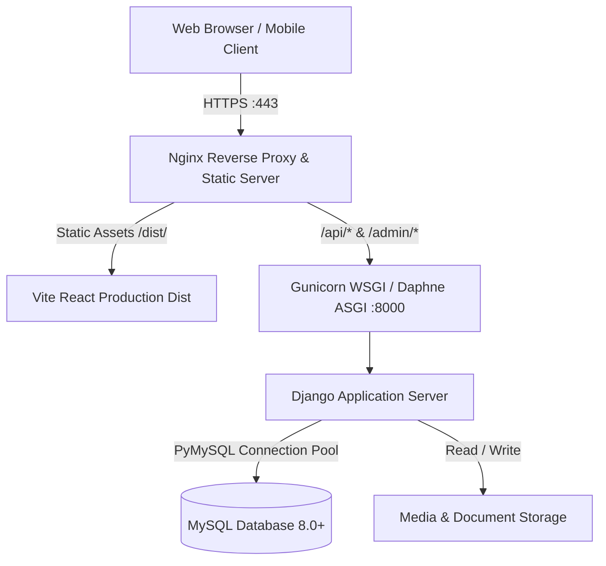

# AMW (Amit Mobile World) - Production Deployment Guide

This document outlines the step-by-step procedures for deploying AMW to a production environment (Linux/Ubuntu, Nginx, Gunicorn/Daphne, MySQL 8.0, and Vite Frontend).

---

## 1. Architecture Overview



---

## 2. Server Prerequisites

Ensure your host server meets the following requirements:
- **Operating System**: Ubuntu 22.04 LTS / 24.04 LTS (or compatible Debian/RHEL)
- **Runtime**: Python 3.11 - 3.13
- **Node.js**: Node 18.x or 20.x LTS with npm
- **Database**: MySQL Server 8.0+
- **Web Server**: Nginx with HTTP/2 and SSL/TLS module
- **Process Manager**: systemd / supervisor

Install core system packages:
```bash
sudo apt update && sudo apt upgrade -y
sudo apt install -y python3-pip python3-venv python3-dev \
    default-libmysqlclient-dev build-essential \
    nginx git curl pkg-config libssl-dev
```

---

## 3. Database Setup (MySQL 8.0)

Log in to MySQL as root:
```bash
sudo mysql -u root -p
```

Create the database and a dedicated production user with utf8mb4 encoding:
```sql
CREATE DATABASE amw_db CHARACTER SET utf8mb4 COLLATE utf8mb4_unicode_ci;

CREATE USER 'amw_prod_user'@'localhost' IDENTIFIED BY 'StrongRandomPassword_AMW2026!';
GRANT ALL PRIVILEGES ON amw_db.* TO 'amw_prod_user'@'localhost';
FLUSH PRIVILEGES;
EXIT;
```

---

## 4. Backend Deployment Steps

### 4.1 Clone Repository and Setup Virtual Environment
```bash
cd /var/www
sudo git clone <YOUR_REPOSITORY_URL> amw
sudo chown -R www-data:www-data /var/www/amw
cd /var/www/amw/backend

# Create virtual environment
python3 -m venv .venv
source .venv/bin/activate
pip install --upgrade pip
pip install -r requirements.txt
pip install gunicorn
```

### 4.2 Configure Production Environment (`.env`)
Create `/var/www/amw/backend/.env`:
```ini
DEBUG=False
SECRET_KEY=generate-a-secure-50-character-key-here-do-not-share
ALLOWED_HOSTS=api.yourdomain.com,yourdomain.com,127.0.0.1
CORS_ALLOWED_ORIGINS=https://yourdomain.com,https://www.yourdomain.com

DB_TYPE=mysql
DB_NAME=amw_db
DB_USER=amw_prod_user
DB_PASSWORD=StrongRandomPassword_AMW2026!
DB_HOST=127.0.0.1
DB_PORT=3306

STATIC_ROOT=/var/www/amw/backend/staticfiles
MEDIA_ROOT=/var/www/amw/backend/media
```

### 4.3 Database Migrations and Static Collection
```bash
source .venv/bin/activate
python manage.py migrate
python manage.py collectstatic --noinput
python manage.py check --deploy
```

### 4.4 Systemd Service for Gunicorn
Create `/etc/systemd/system/amw-backend.service`:
```ini
[Unit]
Description=AMW Django Backend Daemon
After=network.target mysql.service

[Service]
User=www-data
Group=www-data
WorkingDirectory=/var/www/amw/backend
EnvironmentFile=/var/www/amw/backend/.env
ExecStart=/var/www/amw/backend/.venv/bin/gunicorn \
    --workers 4 \
    --threads 2 \
    --bind 127.0.0.1:8000 \
    --access-logfile /var/log/amw/gunicorn-access.log \
    --error-logfile /var/log/amw/gunicorn-error.log \
    config.wsgi:application

Restart=always
RestartSec=5

[Install]
WantedBy=multi-user.target
```

Enable and start the service:
```bash
sudo mkdir -p /var/log/amw
sudo chown -R www-data:www-data /var/log/amw
sudo systemctl daemon-reload
sudo systemctl enable amw-backend
sudo systemctl start amw-backend
sudo systemctl status amw-backend
```

---

## 5. Frontend Deployment Steps

### 5.1 Build Frontend
```bash
cd /var/www/amw/frontend
npm ci
```

Create `/var/www/amw/frontend/.env`:
```ini
VITE_API_BASE_URL=https://api.yourdomain.com
```

Build the optimized production bundle:
```bash
npm run build
```
The compiled output is located in `/var/www/amw/frontend/dist/`.

---

## 6. Nginx Reverse Proxy & SSL Configuration

Create `/etc/nginx/sites-available/amw`:
```nginx
# Upstream Gunicorn Server
upstream amw_backend {
    server 127.0.0.1:8000;
}

# Redirect HTTP to HTTPS
server {
    listen 80;
    listen [::]:80;
    server_name yourdomain.com www.yourdomain.com api.yourdomain.com;
    return 301 https://$host$request_uri;
}

# HTTPS Main Server
server {
    listen 443 ssl http2;
    listen [::]:443 ssl http2;
    server_name yourdomain.com www.yourdomain.com;

    # SSL Certificates (managed via Certbot)
    ssl_certificate /etc/letsencrypt/live/yourdomain.com/fullchain.pem;
    ssl_certificate_key /etc/letsencrypt/live/yourdomain.com/privkey.pem;
    include /etc/letsencrypt/options-ssl-nginx.conf;
    ssl_dhparam /etc/letsencrypt/ssl-dhparams.pem;

    # Frontend Single Page Application
    root /var/www/amw/frontend/dist;
    index index.html;

    # Gzip / Brotli Compression
    gzip on;
    gzip_types text/plain text/css application/json application/javascript text/xml application/xml application/xml+rss text/javascript image/svg+xml;
    gzip_vary on;

    # Cache Control for Hashed Assets
    location /assets/ {
        expires 1y;
        add_header Cache-Control "public, no-transform, immutable";
    }

    # SPA Fallback
    location / {
        try_files $uri $uri/ /index.html;
    }

    # Backend API Proxy
    location /api/ {
        proxy_pass http://amw_backend;
        proxy_set_header Host $host;
        proxy_set_header X-Real-IP $remote_addr;
        proxy_set_header X-Forwarded-For $proxy_add_x_forwarded_for;
        proxy_set_header X-Forwarded-Proto $scheme;
        proxy_read_timeout 60s;
    }

    # Django Admin Proxy
    location /admin/ {
        proxy_pass http://amw_backend;
        proxy_set_header Host $host;
        proxy_set_header X-Real-IP $remote_addr;
        proxy_set_header X-Forwarded-For $proxy_add_x_forwarded_for;
        proxy_set_header X-Forwarded-Proto $scheme;
    }

    # Static Assets collected by Django
    location /static/ {
        alias /var/www/amw/backend/staticfiles/;
        expires 30d;
        add_header Cache-Control "public, max-age=2592000";
    }

    # Uploaded Media Files
    location /media/ {
        alias /var/www/amw/backend/media/;
        expires 7d;
        add_header Cache-Control "public, max-age=604800";
    }

    client_max_body_size 25M;
}
```

Enable site configuration and issue SSL:
```bash
sudo ln -s /etc/nginx/sites-available/amw /etc/nginx/sites-enabled/
sudo nginx -t
sudo systemctl reload nginx

# Install SSL with Certbot
sudo apt install -y certbot python3-certbot-nginx
sudo certbot --nginx -d yourdomain.com -d www.yourdomain.com -d api.yourdomain.com
```

---

## 7. Production Checklist & Verification

- [ ] `DEBUG=False` configured in `backend/.env`.
- [ ] Unique 50+ character `SECRET_KEY` generated.
- [ ] MySQL database UTF8mb4 configured and migrations applied.
- [ ] Static files collected into `STATIC_ROOT`.
- [ ] Gunicorn systemd service active and running.
- [ ] Frontend built with correct `VITE_API_BASE_URL`.
- [ ] Nginx proxies `/api/` and serves `/` SPA fallback without 404s on browser reload.
- [ ] SSL TLS 1.3 certificates verified and automated renew tested (`sudo certbot renew --dry-run`).
- [ ] Periodic MySQL automated backup cron configured:
  ```bash
  0 2 * * * mysqldump -u amw_prod_user -pStrongPassword amw_db | gzip > /var/backups/amw_db_$(date +\%F).sql.gz
  ```

